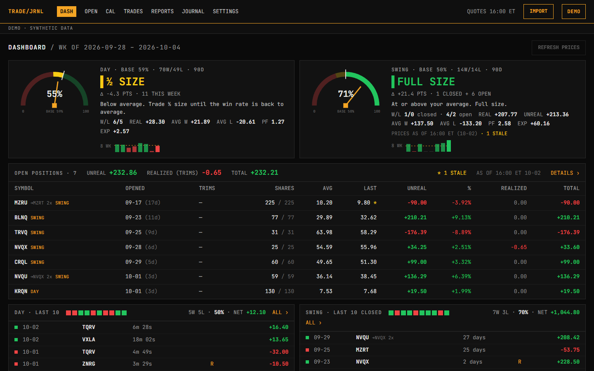
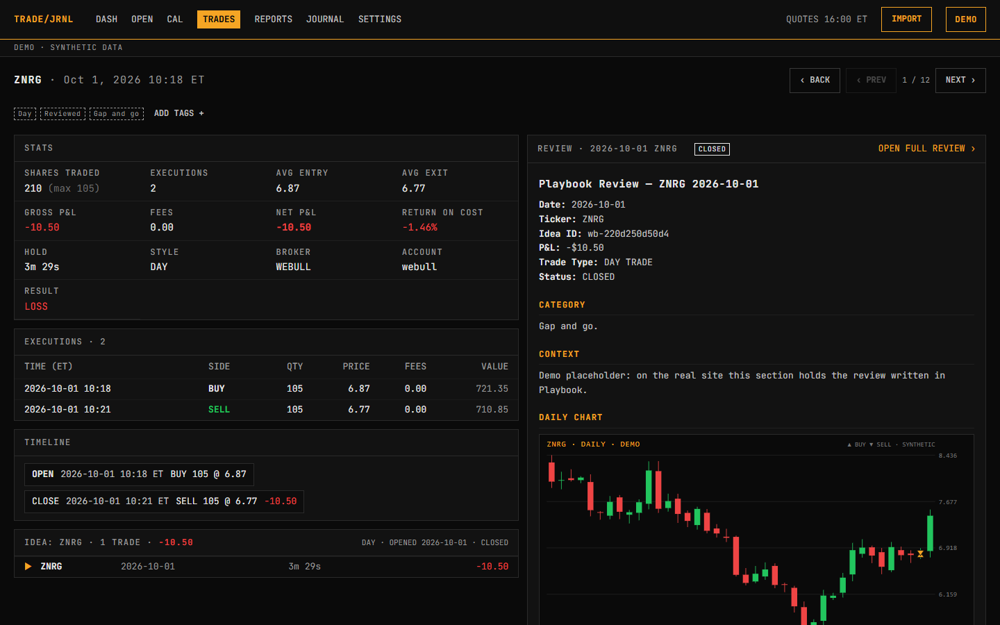
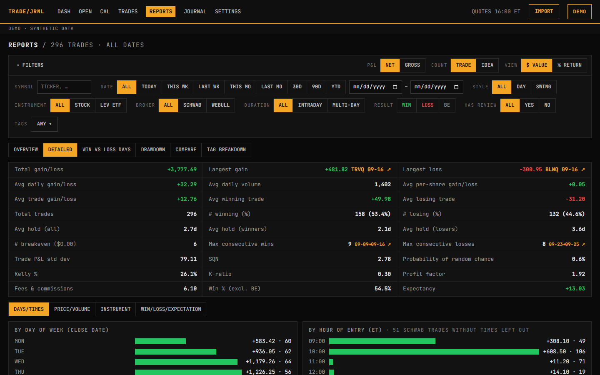
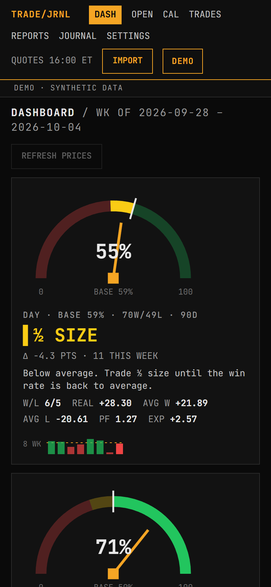

# Trade Journal

[](https://github.com/Lykam/trade-journal/actions/workflows/ci.yml)

A personal, Tradervue-style trading journal for a day account and a swing
account. Its centerpiece is a pair of weekly "temperature gauges" that compare
this week's win rate with the 90-day average and say whether to trade at full,
½ or ¼ size.

**[Live demo →](https://lykam.github.io/trade-journal/demo/)** (synthetic data,
generated in your browser; nothing to log in to)



## Features

- **Gauges:** day and swing win rate vs. baseline, with open swing positions
  marked to market, an 8-week sparkline and the size recommendation.
- **Open positions** with adds, trims, realized and unrealized P&L.
- **Trades** table with filters kept in the URL, bulk tags, style and exclude;
  **trade detail** with executions, timeline, the linked review and charts.
- **Quotes:** trading quotes worth keeping, with source, link and tags.
- **COT:** Commitments of Traders positioning across 44 futures, in the style
  of a crowded-market report: a heads-up list, a price / net positions / rank
  chart per market, and every market by sector (public CFTC and Yahoo data).
- **Movers:** every week's US stocks that moved 50%+ either way on $100M+
  average daily dollar volume, priced over $5: a research list going back two
  years, refreshed every Saturday, with filters for direction, faded vs held
  moves and liquidity, a TRADED mark when you were in it that week, and a
  short note (200 characters) per mover, saved to the private data repo.
- **Plays:** your Playbook setups (markets, timeframes, entry tactics, a
  write-up with images and dated updates), each saved as one `.md` file.
- **Lookups:** single-stock inverse ETFs for each underlying.
- **Calendar**, **Reports** (stats grid, breakdowns, win vs loss days,
  drawdown, compare, tag breakdown), a **Journal** of Playbook reviews and
  **Errors** (mistakes tagged in reviews).
- **Import** of Schwab and Webull CSV exports in the browser or from a CLI,
  with a preview before anything is written.

| Trade detail | Reports | Phone |
|---|---|---|
|  |  |  |

## Run it locally

```
npm install
npm run dev:demo         # the demo at http://localhost:5175/trade-journal/demo/ (synthetic data)
npm test                 # Vitest, synthetic fixtures only
npm run typecheck
```

## How the real site works

The app's code is public; the data is not. Trades live in a private
`trade-history` repo and reviews in a private `Playbook` repo. A GitHub Action
builds the site, encrypts the data (AES-256-GCM, key from a passphrase) and
deploys it to GitHub Pages, so the published files are ciphertext and only the
owner can unlock them in the browser. The demo is a separate build with the
encryption, storage and GitHub code compiled out.

See [`docs/SPEC.md`](docs/SPEC.md) for the specification, the security model
(§2, §8) and the decisions log (§10).

<details>
<summary>Owner commands (need the private sibling checkouts)</summary>

```
npm run dev              # app with local plaintext data from ../trade-history and ../Playbook
npm run dev:fixtures     # the same on the test fixtures (port 5174)
npm run import -- --dry-run [--all] [files…]   # preview an import into ../trade-history
npm run trades -- --date 2026-10-01 --style swing
npm run verify           # recompute and check derived/trades.json
npm run quotes           # price open positions -> quotes.json (gitignored; prints counts only)
npm run movers           # weekly big movers -> movers.json + movers.csv (gitignored); see below
npm run movers -- --publish   # ...and commit movers.json to trade-history (redeploys the site)
npm run scan             # before committing: check added lines for private data
npm run build            # production build + leak guard (no data in dist/)
npm run build:demo       # the public demo into dist-demo/ + its checks; npm run serve:demo serves it
SITE_PASSPHRASE=… npm run encrypt   # bundle + encrypt into dist/data.enc, dist/img/*.enc
npm run check:dist -- --encrypted   # leak guard on the encrypted dist
npm run preview:demo     # encrypted production site on fixtures (port 4174), demo passphrase printed
```

Deploys run from `deploy.yml` (push to main, `repository_dispatch` from the
data repos, manual) and `prices.yml` (every 15 minutes in market hours), both
through `build-deploy.yml`; see SPEC §7.

</details>

<details>
<summary>Weekly movers pipeline (MOVERS page, SPEC §6.7f, Q85)</summary>

How the pieces fit:

1. **Data source:** [Massive](https://massive.com) (formerly Polygon.io), free
   plan: 5 calls/minute, 2 years of history. The key is a Windows user
   environment variable, `POLYGON_API_KEY` (or `MASSIVE_API_KEY`), and is never
   committed or put in Actions.
2. **Fetch and compute:** `build/fetch-movers.ts` (`npm run movers`). It
   - pulls grouped daily bars, one call per market day for every US ticker, into
     `_cache/movers/days/<date>.json.gz` (gitignored). Cached days are never
     refetched, so an interrupted backfill resumes where it stopped;
   - pulls splits (`_cache/movers/splits.json`, refreshed daily) and the list of
     common stocks and ADRs, delisted included (`_cache/movers/stocks.json`,
     refreshed weekly);
   - runs the pure rule in `src/core/movers/movers.ts` (`computeMovers`,
     `DEFAULT_CRITERIA`) and writes `movers.json` and `movers.csv` here
     (both gitignored).
3. **Publish:** `--publish` commits `movers.json` to the private
   `trade-history` repo through the GitHub API, using `GITHUB_TOKEN` or
   `gh auth token`. That push fires trade-history's `notify-journal.yml`,
   which redeploys the site. `build/load-bundle.ts` (`readMovers`) bundles
   trade-history's `movers.json`. Without a checkout (`npm run dev:fixtures`),
   it falls back to the local `movers.json`.
4. **Schedule:** the Windows scheduled task **TradeJournal Movers** runs
   `build/movers-task.ps1` every Saturday at 09:00, or at the next opportunity
   if the PC was off. It runs as the user and needs no admin rights. The log is
   `_cache/movers-task.log`.
   ```
   powershell -NoProfile -ExecutionPolicy Bypass -File build\movers-task.ps1 -Register   # (re)create it
   Start-ScheduledTask -TaskName "TradeJournal Movers"                                    # run it now
   Unregister-ScheduledTask -TaskName "TradeJournal Movers" -Confirm:$false               # remove it
   ```
5. **Page:** `src/app/pages/MoversPage.tsx` (route `#/movers`). Its only write
   is the row notes: trade-history's `mover-notes.json`, committed from the
   browser by `src/core/movers/notes-commit.ts` (Q86), and kept apart from
   `movers.json` so the weekly run never touches them.
   The demo uses invented movers from `src/demo/movers.ts`.

Notes: a full backfill from an empty cache takes about 2 hours, because of the
free plan's rate limit. The free plan's 2-year window moves forward, but cached days
stay in the computation, so the history keeps growing. Don't delete
`_cache/movers/days/`.
Bankruptcy re-listings and unrecorded reverse splits can show up as huge fake
moves, so check rows over about 1,000%. To change the rule, edit
`DEFAULT_CRITERIA` and rerun. Recomputing from the cache needs no new fetches.

</details>
